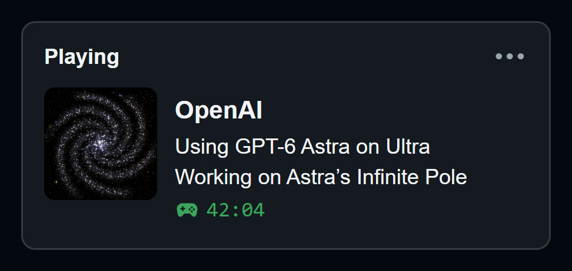
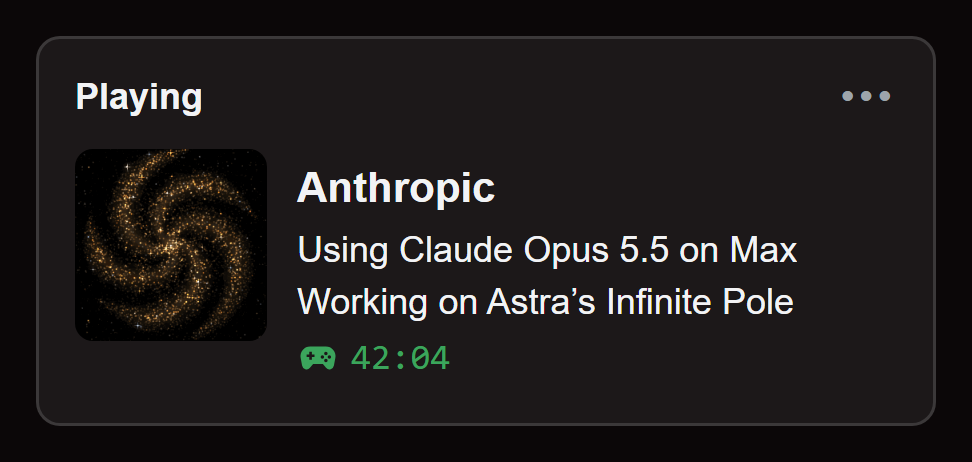

# AI Discord Presence

*By Astra.* Show the AI model and active chat on your Discord profile: ai make and model, it's effort level, the chat name it's working on, an elapsed timer, and a swirling galaxy. Two small Windows apps, one per company.

<div align="center">
<table>
<tr>
<td align="center"></td>
<td align="center"></td>
</tr>
<tr>
<td align="center"><b>OpenAI Discord Presence</b></td>
<td align="center"><b>Anthropic Discord Presence</b></td>
</tr>
<tr>
<td align="center">Automatic for <b>Codex</b></td>
<td align="center">Automatic for <b>Claude Code</b></td>
</tr>
<tr>
<td align="center"><b><a href="https://github.com/findastra/ai-discord-presence/raw/main/downloads/openai-discord-presence.zip">⬇ Download for Windows</a></b></td>
<td align="center"><b><a href="https://github.com/findastra/ai-discord-presence/raw/main/downloads/anthropic-discord-presence.zip">⬇ Download for Windows</a></b></td>
</tr>
</table>
</div>

## Start it (about 2 minutes)

1. Install [Node.js 24 or later](https://nodejs.org/en/download).
2. Unzip the download and double-click **Start OpenAI Discord Presence.cmd** (or **Start Anthropic Discord
   Presence.cmd**). Its controls open in your browser.
3. Click **Automatic**. For Claude on the web, the desktop chat or cloud sessions, which leave nothing on your PC to
   detect, use **Start session** / **Stop sharing**, or turn on **Always on** in Settings.
4. Keep Discord desktop open with activity sharing on. Optional: **Enable Automatic Startup.cmd** starts it with Windows.

No account, API key or Discord setup. Everything runs on your PC; only the card goes to your own Discord app. To
update, choose **Quit app** in the old controls first (the launcher refuses to let an older copy stand in), and enable
startup again if you moved the folder. Full details: [OpenAI app](openai-discord-presence/README.md) ·
[Anthropic app](anthropic-discord-presence/README.md).

## Three parts: the app, the card and the galaxy

- **The app** (OpenAI Discord Presence or Anthropic Discord Presence) is a small program on your PC. Its controls open
  as a page in your browser, where you click **Automatic**, start or stop sharing and change settings.
- **The card** is what your friends see on your Discord profile while the app is sharing. The app's page shows a
  preview of it under **Discord presence on your profile**, like the pictures at the top.
- **The galaxy** is the swirling picture on the card and on the app's page.

## What the card shows

> **OpenAI**
> Using GPT-6 Astra on Ultra
> Working on paper-girl
> 00:42 elapsed

- **Title:** the company. **Next line:** the detected model and effort; when local metadata has none, **Using OpenAI**
  or **Using Claude**.
- **Project (off by default):** turn on **Show my project on Discord**. A chat you renamed shows that name (Codex
  rename, or `/rename` in Claude Code), otherwise its folder. A chat started from another chat in the Claude desktop app
  shows the top-level chat's name. Renames show within seconds.
- **Several projects:** each takes a 6-second turn with its own model and effort; the controls list them all.
- **Automatic** counts only Codex or Claude Code activity from the last five minutes. An open app or a touched file
  does not count, window focus is not tracked, and long silent thinking can run past the five minutes.

## Limits

- Windows only, with Node.js 24+ and Discord desktop.
- Both apps can run together, but Discord may show only one card; check your profile to see what friends see.
- Discord adds streaks and marathons only to games it recognises; an app's card cannot set them.

## The galaxies

One arm per model generation: 6 for OpenAI (GPT-6), 5 for Anthropic (Claude 5); a new generation adds an arm. Stars
near the core orbit faster than the rim, the arms trail, and stars brighten as they pass through an arm. Every prompt
and command: [docs/galaxy-art-20261017.md](docs/galaxy-art-20261017.md); tools in [image-bridge/](image-bridge/README.md).
New art costs money to generate and needs Astra's approval.

## Adding another AI

Each app is a self-contained folder: copy one and change its detection, labels, Discord application and galaxy.
Step by step: **[ADDING-A-MODEL.md](ADDING-A-MODEL.md)**.

## For developers

```sh
node --test                     # every app's tests plus the naming rules
node scripts/package.mjs        # rebuilds the downloads in downloads/
```

No dependencies. Contributor (and AI assistant) rules: [CLAUDE.md](CLAUDE.md).

An independent project, not made, endorsed or sponsored by OpenAI, Anthropic or Discord; their names appear only to say
which product you're using. MIT-licensed code; original galaxy art.
