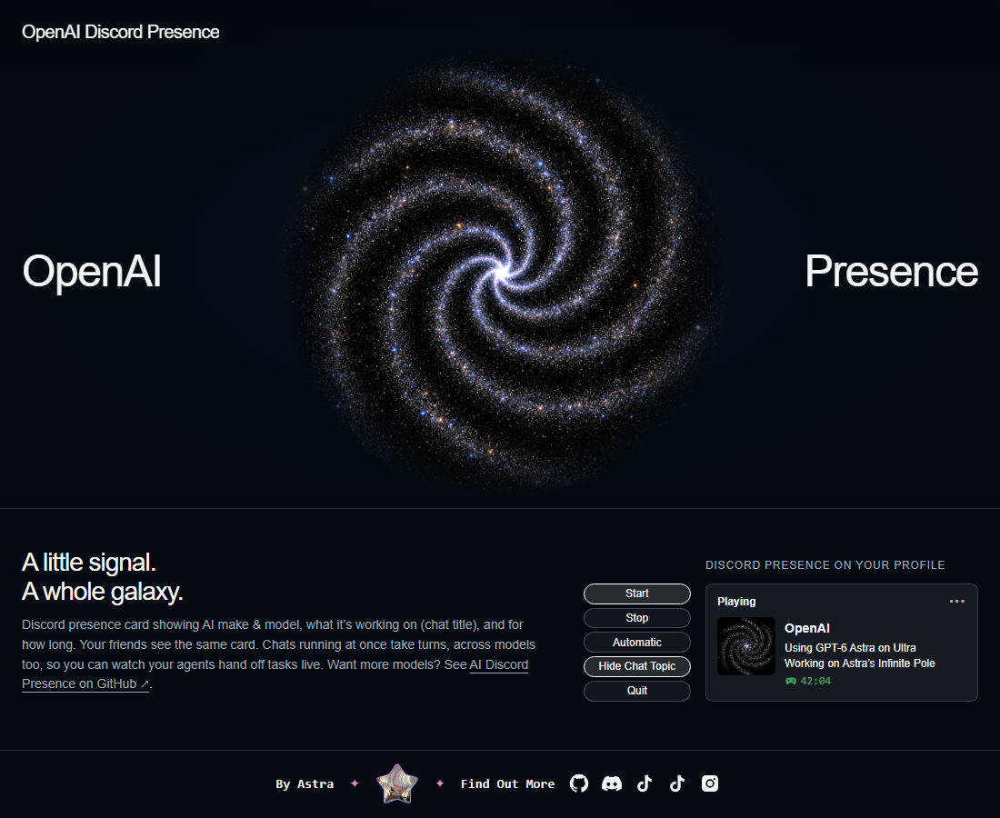

# AI Discord Presence

*By Astra.* Let your Discord friends see what your AI is up to. One small Windows app for Codex, one for Claude Code.

## The Card

What your friends see on your Discord profile while the app is sharing:

<table>
<tr>
<th width="50%"><a href="https://github.com/findastra/openai-discord-presence">OpenAI Discord Presence</a> for Codex</th>
<th width="50%"><a href="https://github.com/findastra/anthropic-discord-presence">Anthropic Discord Presence</a> for Claude Code</th>
</tr>
<tr>
<td width="50%"></td>
<td width="50%"></td>
</tr>
</table>

The company, the model and effort, the chat's name (if you turn it on) and the time. Several chats take turns.

## The App

A small program on your PC. Its page opens in your browser and shows a live preview of your card.

<table>
<tr>
<th width="50%">OpenAI Discord Presence</th>
<th width="50%">Anthropic Discord Presence</th>
</tr>
<tr>
<td width="50%"></td>
<td width="50%"></td>
</tr>
<tr>
<td align="center"><b><a href="https://github.com/findastra/ai-discord-presence/raw/main/downloads/openai-discord-presence.zip">⬇ Download for Windows</a></b></td>
<td align="center"><b><a href="https://github.com/findastra/ai-discord-presence/raw/main/downloads/anthropic-discord-presence.zip">⬇ Download for Windows</a></b></td>
</tr>
<tr>
<td align="center"><a href="openai-discord-presence/README.md">Everything about the OpenAI app</a></td>
<td align="center"><a href="anthropic-discord-presence/README.md">Everything about the Anthropic app</a></td>
</tr>
</table>

### Buttons & Instructions

<table>
<tr>
<th width="200">Button</th>
<th>What it does</th>
</tr>
<tr>
<td width="200" align="center" valign="middle"></td>
<td valign="middle">Puts the card on your profile now and starts the timer, until you click Stop or Quit. Use it for Claude on the web, desktop chat and cloud sessions.</td>
</tr>
<tr>
<td width="200" align="center" valign="middle"></td>
<td valign="middle">Takes the card off your profile. The app keeps running.</td>
</tr>
<tr>
<td width="200" align="center" valign="middle"></td>
<td valign="middle">Shows the card while Codex or Claude Code is working, and hides it five minutes after.</td>
</tr>
<tr>
<td width="200" align="center" valign="middle"></td>
<td valign="middle">Takes the chat's name off the card. Click it again (Show Chat Topic) to put it back.</td>
</tr>
<tr>
<td width="200" align="center" valign="middle"></td>
<td valign="middle">Closes the app. Click it twice within 3 seconds.</td>
</tr>
</table>

## Quirks

1. **Automatic** sees Codex and Claude Code only. Claude on the web, desktop chat and cloud sessions leave nothing on
   your PC to detect: click **Start** instead.
2. Automatic counts activity from the last five minutes. An open app or a touched file does not count, window focus is
   not tracked, and a long silent think can run past the five minutes.
3. Discord desktop must be open, with activity sharing on.
4. When no model is found, the card says **Using OpenAI** or **Using Claude** instead of guessing.
5. **Chat Topic** is the name you gave the chat (rename in Codex, `/rename` in Claude Code), otherwise its folder. A
   chat started from another chat in the Claude desktop app shows the first chat's name. Automatic chat titles are
   never used.
6. Several chats take 6-second turns: Discord accepts about five updates per 20 seconds.
7. The timer counts time shared, not the AI's thinking time.
8. Closing the browser tab leaves the app running. Start, Automatic, Stop and Quit are also in its galaxy tray icon by
   the clock (right-click it).
9. Both apps can run together, but Discord may show only one card; check your profile to see what friends see.
10. Discord adds streaks and marathons only to games it recognises; an app's card cannot set them.
11. **Privacy:** the apps read only the model, effort, times and folder or chat names, never prompts, replies or automatic
   titles. Only the card goes to your Discord.
12. To update, click **Quit** in the old copy first (the launcher refuses to let an older copy stand in), and run
   **Enable Automatic Startup.cmd** again if you moved the folder.
13. Windows only, with Node.js 24+ and Discord desktop.

## Developer Notes

1. **Built with:** OpenAI Discord Presence by OpenAI Codex (GPT-6), from 2026-09-12. Anthropic Discord Presence, the
   shared repo, the galaxy art and the image bridge by Claude Opus 5.5, from 2026-10-06. Full list: the "Built with"
   lines in [AGENTS.md](AGENTS.md).
2. **What's where:** one folder per app (`openai-discord-presence/`, `anthropic-discord-presence/`, each with `src/`,
   `public/`, `scripts/` and `test/`); `downloads/` holds the built ZIPs; `image-bridge/` makes the galaxies; `docs/`
   has the art recipe and the README pictures; `test/` checks names and the controls pages across both apps.
3. **Run from source:** `node src/server.js` in an app folder. The page is `http://127.0.0.1:38761/` (OpenAI) or
   `http://127.0.0.1:38762/` (Anthropic); `OPENAI_PRESENCE_PORT` or `ANTHROPIC_PRESENCE_PORT` changes it. The server
   listens on 127.0.0.1 only and checks Host and Origin on every change.
4. **Settings** live in each app's git-ignored `.local/config.json`. Never commit it, or any log or cache.
5. **Tests** (every app plus the naming rules): `node --test`. Add tests with every behaviour change. **Rebuild the
   downloads** with `node scripts/package.mjs` before pushing any app change. No dependencies.
6. **The card's galaxy** is loaded by Discord from `<app>/public/galaxy-card.gif` on this repo's `main` branch
   (`GALAXY_URL` in `src/presence.js`). Moving or renaming it breaks every running card; when the art changes, bump
   its `?v=` so Discord fetches it again.
7. **The galaxies:** one arm per model generation (6 for GPT-6, 5 for Claude 5); a new generation adds an arm. Stars
   near the core orbit faster than the rim, the arms trail, and stars brighten as they pass through an arm. GIFs stay
   under 10 MB. Every prompt and command: [docs/galaxy-art-20261017.md](docs/galaxy-art-20261017.md); tools in
   [image-bridge/](image-bridge/README.md) (`imagine.mjs` is also used by `astras-pet-os`, so don't move it). New art
   costs money to generate and needs Astra's approval.
8. **Turns:** `ROTATE_MS` in `src/presence.js` is 6000, Discord's safe limit. Don't lower it.
9. **Detection reads metadata only:** never conversation text, prompts or automatic chat titles. Rules:
   [CLAUDE.md](CLAUDE.md), Privacy.
10. **Adding another AI:** each app is a self-contained folder: copy one and change its detection, labels, Discord
   application and galaxy. Step by step: [ADDING-A-MODEL.md](ADDING-A-MODEL.md).
11. **Rules and handoffs:** [CLAUDE.md](CLAUDE.md) and [AGENTS.md](AGENTS.md) for contributors and AI assistants; open
   work in [handoffs/](handoffs/README.md); report a vulnerability through [SECURITY.md](SECURITY.md).

## Legal

1. An independent project, not made, endorsed or sponsored by OpenAI, Anthropic or Discord.
2. Their names appear only to say which product you're using.
3. The code is MIT-licensed: [LICENSE](LICENSE).
4. The galaxy art is original.
