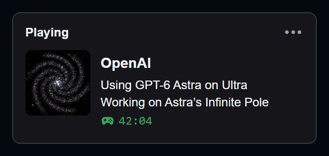

# AI Discord Presence

*By Astra.* Show your friends on Discord which AI you're working with, which model, what it's working on and for how
long. Two small Windows apps, one per company.

<table>
<tr>
<td width="50%" align="center"></td>
<td width="50%" align="center"></td>
</tr>
<tr>
<td align="center"><b><a href="https://github.com/findastra/openai-discord-presence">OpenAI Discord Presence</a></b></td>
<td align="center"><b><a href="https://github.com/findastra/anthropic-discord-presence">Anthropic Discord Presence</a></b></td>
</tr>
<tr>
<td align="center"><b><a href="https://github.com/findastra/ai-discord-presence/raw/main/downloads/openai-discord-presence.zip">⬇ Download for Windows</a></b></td>
<td align="center"><b><a href="https://github.com/findastra/ai-discord-presence/raw/main/downloads/anthropic-discord-presence.zip">⬇ Download for Windows</a></b></td>
</tr>
<tr>
<td valign="top">
<b>Automatic sees:</b> Codex chats (not archived chats or subagents).  
<b>Start file:</b> Start OpenAI Discord Presence.cmd  
<b>Chat Topic:</b> the name you gave the chat in Codex, else its folder, else its saved Codex project.  
<b>No model found:</b> the card says Using OpenAI.  
<a href="openai-discord-presence/README.md">Everything about this app</a>
</td>
<td valign="top">
<b>Automatic sees:</b> Claude Code, including Code sessions in the Claude desktop app. Claude on the web, desktop chat and cloud sessions leave nothing to detect: click <b>Start</b>.  
<b>Start file:</b> Start Anthropic Discord Presence.cmd  
<b>Chat Topic:</b> the name you gave it with <code>/rename</code>, else its folder. A chat started from another chat shows the first chat's name.  
<b>No model found:</b> the card says Using Claude.  
<a href="anthropic-discord-presence/README.md">Everything about this app</a>
</td>
</tr>
</table>

## The card

What your friends see on your Discord profile:

- **The company**, then **the model and effort** it detects.
- **The chat's name**, only if you turn on **Show Chat Topic**.
- **The time** since you started.
- Several chats at once take 6-second turns, each with its own model.

## The app

A small program on your PC. Its page opens in your browser with five buttons: **Start**, **Stop**, **Automatic**,
**Show Chat Topic** and **Quit**.

1. Install [Node.js 24 or later](https://nodejs.org/en/download).
2. Download your app from the table above, unzip it and double-click its start file.
3. Click **Automatic**, and keep Discord desktop open with activity sharing on.

Optional: **Enable Automatic Startup.cmd** starts it with Windows. No account, API key or Discord setup; everything
runs on your PC and only the card goes to your own Discord.

## Quirks

- Automatic counts activity from the last five minutes, so a long silent think can drop off for a moment.
- Both apps can run together, but Discord may show only one card.
- To update, click **Quit** in the old copy first, and run **Enable Automatic Startup.cmd** again if you moved the
  folder.
- Windows only.

## How it was made

- OpenAI Discord Presence: OpenAI Codex (GPT-6), from 2026-09-12.
- Anthropic Discord Presence, the shared repo and the galaxy art: Claude Opus 5.5.
- Each galaxy has one arm per model generation (6 for GPT-6, 5 for Claude 5). Recipe:
  [docs/galaxy-art-20261017.md](docs/galaxy-art-20261017.md).
- Add another AI: [ADDING-A-MODEL.md](ADDING-A-MODEL.md).

Tests (every app plus the naming rules): `node --test`. Rebuild the downloads: `node scripts/package.mjs`. No
dependencies. Contributor (and AI assistant) rules: [CLAUDE.md](CLAUDE.md).

An independent project, not made, endorsed or sponsored by OpenAI, Anthropic or Discord. MIT-licensed code; original
galaxy art.
