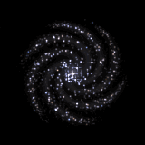
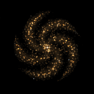

# Findastra Discord Presence

*By Astra.* Managed by **Discord Damsel**, one of the pets in [Astra's PetOS](https://github.com/findastra/astras-pet-os).

Share AI activity on your Discord profile: the model and effort level when local metadata exposes them, an optional project name, an elapsed timer, and a swirling galaxy.

Two small Windows apps, one for each company's models. Both can run together, but Discord may display only one card even when it accepts both activities. Each card was verified individually on Discord desktop; simultaneous display is not guaranteed.

| | |
|:---:|:---:|
|  |  |
| **OpenAI Discord Presence** | **Anthropic Discord Presence** |
| Automatic for **Codex** | Automatic for **Claude Code** |
| **[⬇ Download for Windows](https://github.com/findastra/findastra-discord-presence/raw/main/downloads/openai-discord-presence.zip)** | **[⬇ Download for Windows](https://github.com/findastra/findastra-discord-presence/raw/main/downloads/anthropic-discord-presence.zip)** |

Claude on the web, the desktop chat and cloud sessions leave nothing on your PC to detect: use **Start session**, or turn on **Always on** in the Anthropic app.

## Start it (about 2 minutes)

1. Install [Node.js 24 or later](https://nodejs.org/en/download) if you don't have it.
2. Download and unzip the app(s) you want.
3. Double-click **Start OpenAI Discord Presence.cmd** (or **Start Anthropic Discord Presence.cmd**) in the unzipped folder. Your browser opens its controls.
4. Click **Automatic** for Codex or Claude Code. For regular Claude desktop chat, use **Start session** and **Stop sharing**, or turn on **Always on** in Settings. Keep Discord desktop open with activity sharing enabled.
5. Optional: double-click **Enable Automatic Startup.cmd** once so it starts with Windows.

When updating, quit the running companion from its control panel before opening the new copy. The launcher checks the installation and build so an older process cannot silently stand in for the update. If you move the folder, enable startup again from the new location.

No account, API key or Discord setup needed. Everything runs on your own computer; nothing is sent anywhere except the card itself to your own Discord app. Details: [OpenAI app](openai-discord-presence/README.md) · [Anthropic app](anthropic-discord-presence/README.md).

## What the card shows

> **OpenAI**
> Using GPT-6 Astra on Ultra
> Working on paper-girl
> 00:42 elapsed

The title is the company; the line under it is the detected model and effort level when available. Your project is opt-in: a chat or session you renamed shows that name (Codex rename, or `/rename` in Claude Code), otherwise the folder you're working in. A chat started from another chat in the Claude desktop app shows the top-level chat's name, as the app's sidebar lists it. Renames show within a few seconds. With several projects active, every one takes a turn on the card, one every 6 seconds, each paired with its own model and effort; the control panel lists them all.

Codex and Claude Code expose model metadata. Anthropic Automatic requires Claude Code conversation activity recorded in the last five minutes, including desktop Code sessions with supported local metadata. An open app or a touched transcript file does not count. Regular Claude desktop chat, Claude on the web and cloud sessions have no reliable automatic detector here; use manual **Start session** and **Stop sharing**, or turn on **Always on** in the Anthropic app's Settings to share whenever it runs. Missing model metadata is labeled **Using Claude** or **Using OpenAI**. Detection does not track foreground focus, and an accepted Discord activity is not proof that the profile displays it.

## The galaxies

Each galaxy has **one arm per model generation**: 6 for OpenAI (GPT-6) and 5 for Anthropic (Claude 5). When a new generation ships, its galaxy grows an arm. The animation follows real galaxy physics: stars near the core orbit several times faster than the rim, the arms trail, and stars brighten as they pass through an arm. How the art is made, with every prompt and command: [docs/galaxy-art-20261017.md](docs/galaxy-art-20261017.md); the tools are in [image-bridge/](image-bridge/README.md).

## Adding another AI

Want a card for Gemini, Copilot or another model? Each app is a self-contained folder, so a new one is a copy of an existing app with its detection, labels, Discord application and galaxy changed. Step-by-step guide: **[ADDING-A-MODEL.md](ADDING-A-MODEL.md)**.

## Limits

- Windows only, with Node.js 24 or later and Discord desktop open.
- Discord accepts both cards, but may show only one of them on your profile; check your profile to see what friends see.
- Automatic needs local metadata: Codex for OpenAI, Claude Code for Anthropic. Claude desktop chat, Claude on the web and cloud sessions need **Start session** or **Always on**.
- Model, effort and project come from local metadata and can be missing; the card then says **Using OpenAI** or **Using Claude**.
- Detection does not follow which window is in front, and long silent thinking can exceed the five-minute window.
- New galaxy art costs money to generate and needs Astra's approval ([docs/galaxy-art-20261017.md](docs/galaxy-art-20261017.md)).

## For developers

```sh
node --test                     # every app's tests plus the naming rules
node scripts/package.mjs        # rebuilds the downloads in downloads/
```

No dependencies; Node.js 24 only. Rules for contributors (and AI assistants) are in [CLAUDE.md](CLAUDE.md).

This is an independent project, not made, endorsed or sponsored by OpenAI, Anthropic or Discord. Their names and model names are their trademarks and appear only to say which product you're using. The code is MIT-licensed; the galaxy art is original.
