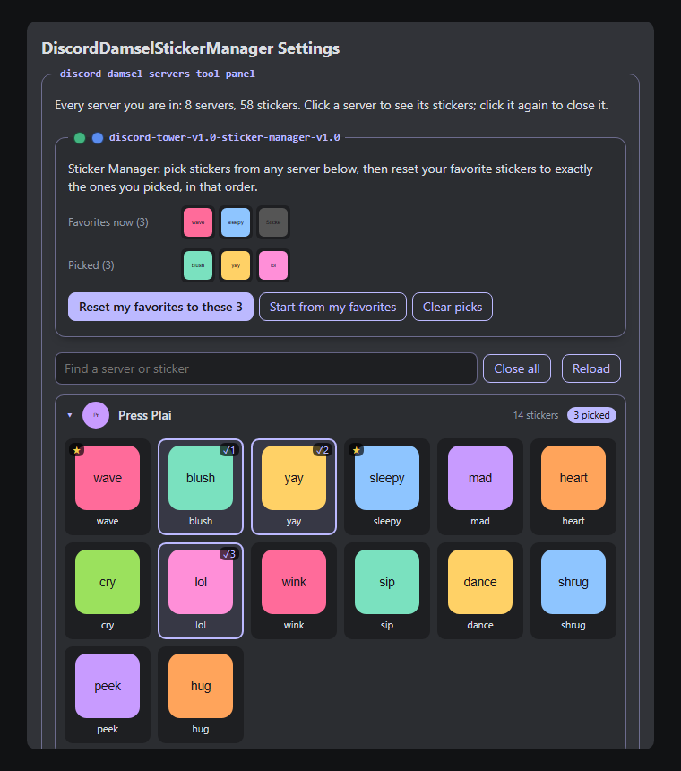

# Sticker Manager

A tool of **Discord Damsel** (Discord Tower, pet program #13 in
[Astra's PetOS](https://github.com/findastra/astras-pet-os)).

| | |
|---|---|
| Tool panel | `discord-damsel-servers-tool-panel` |
| Tool | `discord-tower-v1.0-sticker-manager-v1.0` (version 1.0.1) |
| File | [discord-damsel-sticker-manager-20261018.plugin.js](discord-damsel-sticker-manager-20261018.plugin.js) |
| Runs in | Discord desktop, as a [BetterDiscord](https://betterdiscord.app/) plugin (BetterDiscord is third-party) |

## What it does

- **Every server you are in**, in the same order as the server list on the left of Discord. Click a server to see all
  of its stickers; click it again to close it. A search box finds a server by name, or a sticker by name or tag.
- **Sticker Manager**, inside that tool panel: click stickers from any server to pick them (a ✓ and its number), then
  **Reset my favorites to these N**. Your favorite stickers become exactly your picks, in the order you picked them.
  A ★ marks the stickers that are favorites now.
- **Start from my favorites** picks your current favorites, so you can take some off or add more.
- **Put back my previous favorites** undoes the last reset: the plugin keeps a copy of the list from before it.
- Its two lights: the left one is ON/OFF (green/red). OFF switches picking and resetting off; the server list still
  works. The right one is the maintenance light (blue: working, yellow: requires maintenance). It is kept in this
  plugin only and does not reach the Friendly Farmer yet.



## Install it (about 3 minutes)

1. **BetterDiscord** must be installed in Discord desktop: [betterdiscord.app](https://betterdiscord.app/) (official
   download only). A Discord update can remove it; run its installer again when that happens.
2. Download the plugin: open
   [the plugin file](https://raw.githubusercontent.com/findastra/findastra-discord-presence/main/discord-tower/sticker-manager/discord-damsel-sticker-manager-20261018.plugin.js),
   right-click, **Save as…**, and keep the name exactly (it must end in `.plugin.js`).
3. In Discord: **User Settings → Plugins** (in the BetterDiscord part of the list) → **Open Plugins Folder**, and move
   the file there. The folder is `%APPDATA%\BetterDiscord\plugins`.
4. Turn on **DiscordDamselStickerManager** in the Plugins list, then click its **gear** (Settings) to open the tool panel.

## What it touches

- **Reads**, from the Discord app's own memory: your servers (names, icons, order), their stickers, and your favorite
  stickers. Pictures come from Discord's own media server, the same pictures the sticker picker shows.
- **Changes one thing, only after you confirm:** your favorite stickers. It saves them through Discord's own settings
  saver, the same way Discord saves them when you click the star in the sticker picker. Discord syncs the list to your
  account, so every device sees it.
- **Never:** its own network requests, your token, messages, other settings, or anything outside Discord. Server and
  sticker names are shown as text, never as HTML.
- **Keeps on the PC:** your picks, the copy of your previous favorites and the two lights, in BetterDiscord's file for
  it (`%APPDATA%\BetterDiscord\plugins\DiscordDamselStickerManager.config.json`). Nothing goes to GitHub.

## Limits

- **BetterDiscord is against Discord's Terms of Service**, like every client mod. Discord rarely acts on it, but it
  can. The plugin itself only does what you could do by clicking the stars one by one.
- It needs Discord desktop with BetterDiscord. It does not run on the Discord website, phone or Discord Damsel's own
  page, which links here.
- It finds Discord's lists by their names inside the Discord app. A Discord update can rename them; the plugin then
  says what it could not find and changes nothing.
- **Nitro:** you can favorite any server's stickers, but sending a sticker from another server needs Nitro.
- **Not tested inside Discord yet.** Checked on 2026-10-18 with the Node tests and the test page, which load the real
  plugin with a pretend Discord. BetterDiscord was not installed on Astra's PC that day.
- A server whose stickers Discord has not loaded says so; open that server once in Discord, then click **Reload**.

## For developers

```sh
node --test test/sticker-manager-20261018.test.mjs
```

The tool panel without Discord: serve the repo (`python -m http.server` in the repo root) and open
`/test/sticker-manager-harness-20261018.html`. Add `?empty` for an account with no favorites list yet, or `?broken`
for a Discord the plugin cannot find. It uses pretend servers and coloured squares, and never talks to Discord.

How it finds Discord's internals (the same filters as the Vencord client mod): the stores `GuildStore`,
`SortedGuildStore`, `StickersStore` and `UserSettingsProtoStore` by name, and the favorites saver as the module whose
`ProtoClass.typeName` ends in `.FrecencyUserSettings`; it calls `updateAsync("favoriteStickers", …)`.

Written by Claude Opus 5.5 (`claude-opus-5-5`), 2026-10-18, at Astra's request. MIT license, as the rest of this repo.
