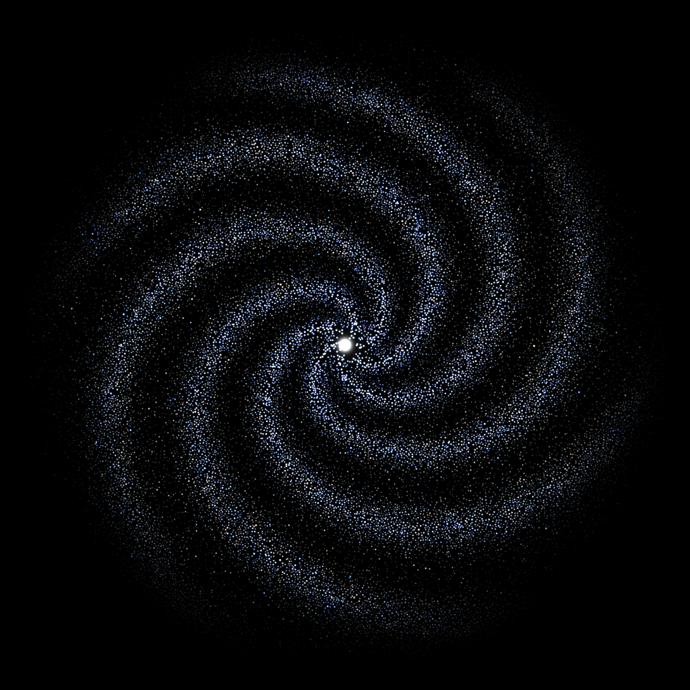
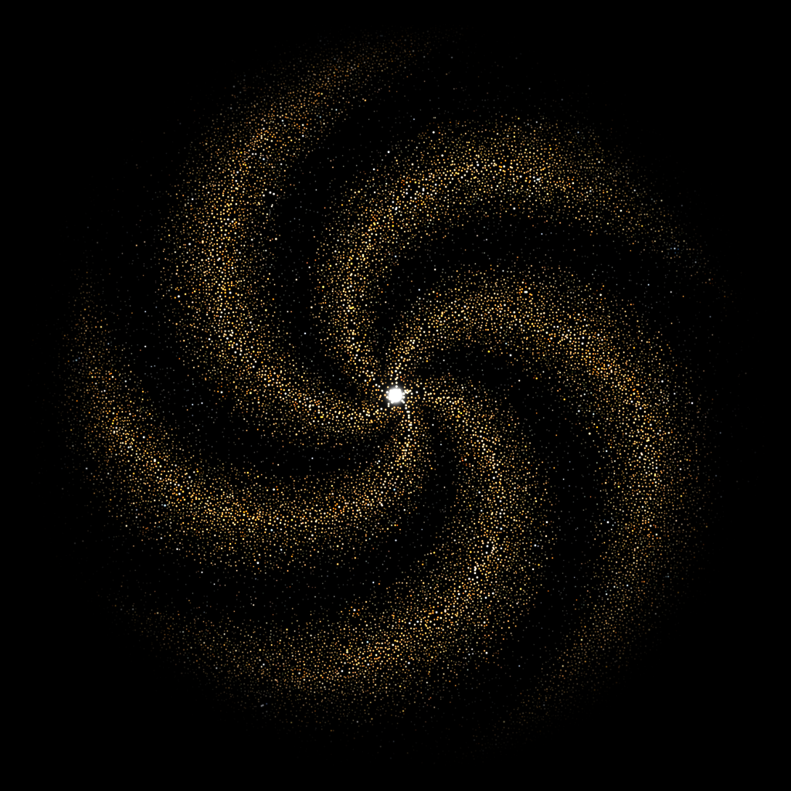

# Official Galaxy Artwork

By Astra. Approved October 30, 2026. Animation built with OpenAI Codex (GPT-6).

These are the official galaxies for **Astra's independent Discord Presence apps**.
They are original project artwork, not official OpenAI or Anthropic branding.

| OpenAI Discord Presence | Anthropic Discord Presence |
|---|---|
|  |  |
| 31,567 original stars | 23,067 original stars |

The apps and [Astra's website](https://findastra.github.io/) draw individual stars
at the display's refresh rate. The spiral stays oriented while stars follow its
curves inward into a soft white spot. The blue balance is preserved, the gold stays
warm, and a broad fade makes the outside fully black. There is no mouse interaction.
Pause stars and the device's reduced-motion preference stop the animation.
The matching 1024-pixel still appears if WebGL 2 is unavailable.

Discord's image field uses a seamless **24-second, 25-fps GIF**: 600 frames at 160px,
below 10 MB. The 240px export is also below 10 MB. Each particle has two staggered
lifetimes for the GIF loop; fixed palettes avoid color flicker. The web animation
is continuous and does not have the GIF's frame or resolution limit.

## Original art and reproducibility

The original 1024-pixel `public/galaxy.png` files and image-bridge masters are unchanged.
Their [original recipe and credits](galaxy-art-20261017.md) remain available.
This animation reconstructs paths from the original art; it is not a recovered older
animation. No new paid image generation or captured company artwork was used.

```sh
node image-bridge/build-official-galaxies-20261030.mjs
node image-bridge/export-official-galaxies-20261030.mjs --playwright=/path/to/playwright --browser=/path/to/chromium --output=/existing/output/folder
node --test
node scripts/package.mjs
```

The builder extracts source-star positions and colors, measures arm winding and
generates each app's data plus an exact copy of the canonical renderer. The export
helper needs an existing Playwright/Chromium installation; runtime apps have no added
dependencies. Copy the exported card/page GIFs to the existing `galaxy-card.gif` /
`galaxy.gif` addresses after review. The 1024-pixel official still is renderer time0.
The storefronts and portfolio carry generated copies, with the source here canonical.

Built-in Discord image URLs use cache version9. Older saved built-in image URLs
upgrade automatically; custom images remain unchanged. Screenshots and card demos
show the same illustrative model/project examples as earlier storefront images.

Validation includes shader execution, frame endpoints and decoded GIF frames, black
borders at multiple times, source color checks, pause, reduced motion, context loss,
narrow screens, app routes and packaged asset completeness. Shared review:
[pull request51](https://github.com/findastra/ai-discord-presence/pull/51).
